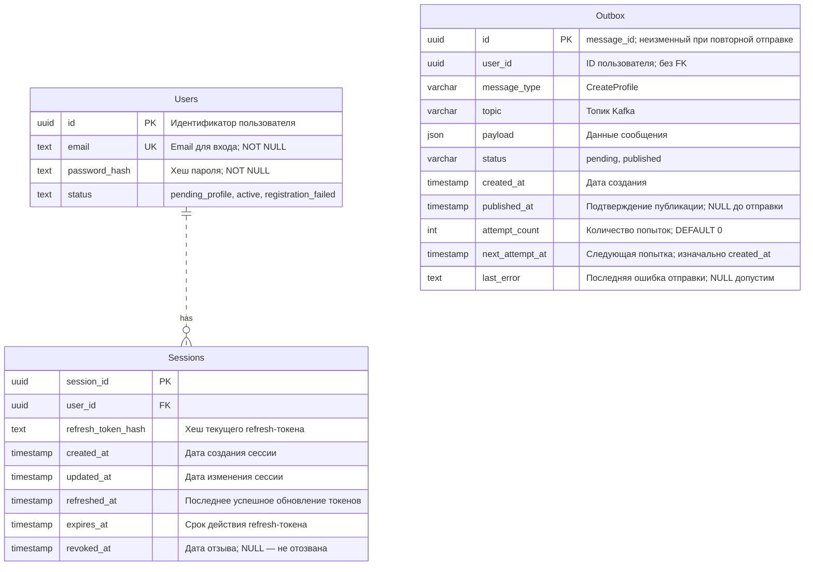

# Описание Auth Service
`auth-service` отвечает за регистрацию аккаунтов, вход по email и паролю, управление сессиями и выпуск JWT access / refresh токенов.

### 1. Разделение данных пользователя между сервисами

Сущность пользователя разделена между двумя независимыми базами данных:

- **БД `auth-service`** хранит данные для аутентификации и сессий: `id` (UUID), `email`, `password_hash`, статус аккаунта (`pending_profile`, `active`, `registration_failed`) и таблицу `sessions`.
- **БД `help-service`** хранит бизнес-профиль пользователя.
- 
Единый идентификатор `user_id` (UUID) генерируется один раз в `auth-service` и передается в `help-service`, чтобы оба сервиса ссылались на одного пользователя.

### 2. Роль Kafka

Kafka используется для асинхронного создания пользователя в `auth-service` и `help-service`:

- Сервиса используют паттерн **Transactional Outbox**, чтобы гарантировать доставку событий брокера.
- В сообщениях передаются технические идентификаторы (`message_id`, `user_id`, ключ партиционирования — `user_id`).

### 3. Сценарий создания пользователя

1. Клиент отправляет `POST /api/v1/auth/register` с `email` и `password` в `auth-service`.
2. `auth-service` назначает `user_id`, сохраняет аккаунт со статусом `pending_profile` и исходящую команду `CreateProfile` в таблицу `outbox`. HTTP-запрос переводится в неблокирующее ожидание (`DeferredResult`).
3. Фоновый `OutboxPublisher` отправляет `CreateProfile` в Kafka.
4. `help-service` получает `CreateProfile` и создает пустой профиль (`profile_status = incomplete`) с тем же `user_id` и записывает ответ `ProfileCreated` в свой `outbox`, после чего публикует его в Kafka.
5. `auth-service` получает `ProfileCreated` и переводит аккаунт из `pending_profile` в `active`.
6. Если исходный HTTP-запрос еще ожидает ответ, `auth-service` создает сессию и возвращает `201 Created` с токенами. Если время ожидания уже истекло, клиенту возвращается `503 REGISTRATION_PENDING` без токенов, но фоновая активация завершается и пользователь может выполнить обычный `login`.
7. Заполнение полей профиля выполняется позже напрямую в `help-service` уже с выданным access-токеном.

### База данных auth-service
