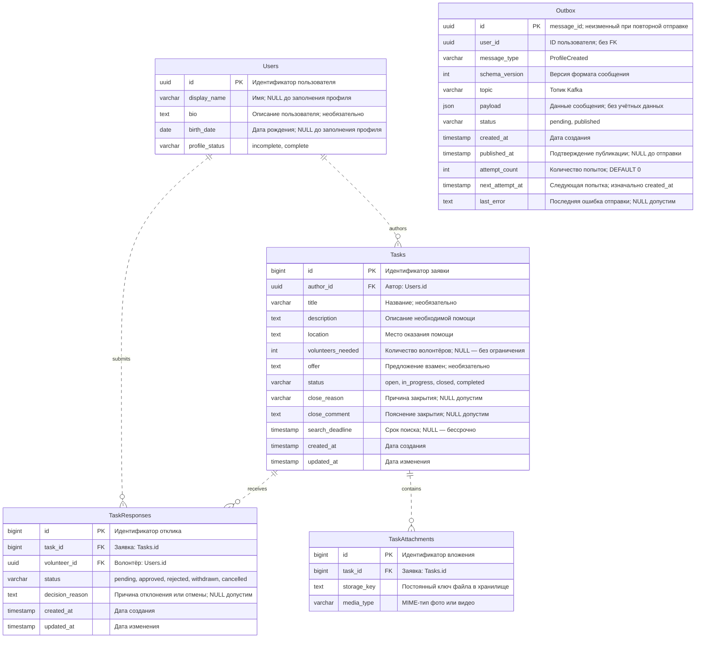
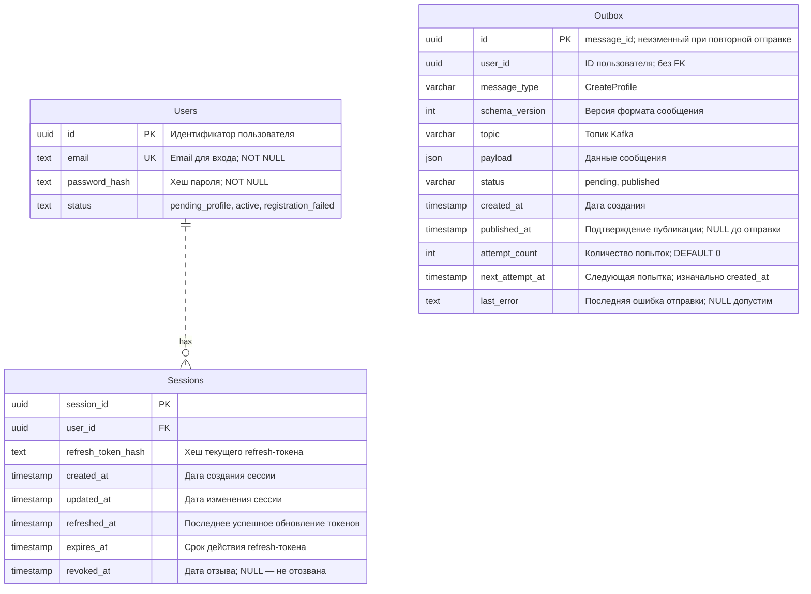
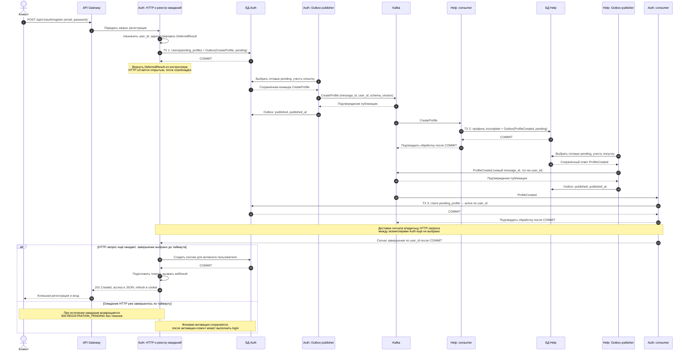

# Проект для поиска волонтеров.

### ТО DO
* сделать более понятной схему архитектуры: отразить все связи и назначения компонентов
* написать auth service и api-gateway
* встроить кафку в auth service
* проверить security цепочки в api-gateway

## Описание
Цель: создание сервиса для быстрого и простого создания заявки на получение помощи (разовой или регулярной).

Сценарий:
1) пользователь А оставляет заявку:
* описывает какая помощь ему нужна
* место
* сколько человек (опционально)
* что может предложить взамен (опционально)
2) пользователь Б откликается на заявку
3) открывается чат с автором заявки и волонтером (или групповой чат)
4) после выполнения помощи волонтер переводит статус в "выполнено", автор заявки подтверждает
5) заявка становится не действительной, отображается у исполнителя как выполненная

## Архитектура сервиса

API Gateway
* проверяет JWT, подставляет внутренние заголовки
* маршрутизирует запросы на другие сервисы

Auth Service
* Создает аккаунт: сохраняет email и пароль
* обновляет access token
* удалят refresh token, если пользователь хочет выйти из аккаунта

Help Service
* создает профиль пользователя
* создает заявки
* создает отклики на заявки

Возможности:
* пользователь должен создать профиль
* пользователь может авторизоваться
* пользователь может создавать, изменять, удалять заявку о помощи (содержит текст + фото, видео)
* пользователь может просмотреть заявки о помощи, чтобы выбрать
* пользователь может откликнуться на заявку о помощи
* автор может перевести заявку в выполненные
* волонтер может отказаться от заявки
* пользователь может просматривать профили других пользователей

TBD:
* автор заявки и волонтер могут обменяться сообщениями в чате
* пользователь может изменять свой профиль: описание, фото

Статусы задачи:

## Базы данных
### База данных help-service

### База данных auth-service

### Согласованные правила и открытые решения

- `help-service.Users.id` совпадает с `auth-service.Users.id`: ID назначает auth-service; help-service не генерирует независимый ID. Между БД нет физического FK. Локальные FK сохраняются.
- Для одного `user_id` существует только один процесс регистрации; перезапуск окончательно отменённой регистрации для того же ID не предусмотрен. Повтор регистрации занятого email, включая аккаунт `pending_profile`, возвращает 409 `EMAIL_ALREADY_EXISTS` и не меняет пароль или текущий процесс. Уникальность email обеспечивается ограничением БД. Если аккаунт удалён и регистрация с тем же email разрешена заново, создаётся новый `user_id`; старый ID не используется повторно.
- Вход — по email и паролю. Email обязателен и уникален по согласованному правилу нормализации; пароль хранится только как хеш. Правило нормализации ещё нужно определить. Подтверждение email и восстановление пароля отложены до будущей версии.
- Используются JWT access-токены со сроком до 15 минут и refresh-токены с ротацией. Сессия имеет фиксированный срок 7 дней: `expires_at = created_at + 7 дней`. При создании `refreshed_at = created_at`; при обновлении меняется только `refreshed_at`, но не `expires_at`. Срок access ограничен концом сессии: `min(время выдачи + 15 минут, expires_at)`.
- Refresh действителен только при совпадении хеша, `revoked_at IS NULL` и текущем времени строго меньше `expires_at`. Обновление атомарно заменяет refresh; старый токен больше не принимается (401). При конкурентном обновлении одним токеном успешен только один запрос. Автоматический отзыв всей сессии при повторном использовании старого токена пока не предусмотрен.
- Logout отзывает текущую сессию и удаляет refresh cookie; клиент удаляет access. Уже выданный JWT действует до своего срока, немедленной проверки отзыва нет. Остальные сессии не отзываются.
- Успешная регистрация автоматически создаёт сессию после активации аккаунта и выдаёт токены. В OpenAPI выбран веб-контракт: access в JSON, refresh в Secure HttpOnly SameSite=Strict cookie с Path=/api/v1/auth; фронтенд и API предполагаются на одном site. Срок cookie равен оставшемуся сроку сессии. Сервер проверяет Origin по списку разрешённых origin.
- Контракт четырёх операций описан в `openapi.yaml`: `POST /api/v1/auth/register`, `/api/v1/auth/login`, `/api/v1/auth/refresh`, `/api/v1/auth/logout`. Если активация регистрации задерживается, ответ — 503 REGISTRATION_PENDING без токенов, фоновая регистрация продолжается; после активации возможен login. Длительность ожидания и автоматическое продолжение входа в интерфейсе ещё требуют детализации.
- `birth_date` и непустой `display_name` обязательны для заполненного профиля (`profile_status = complete`); до заполнения допускается `NULL`. `close_reason`, `close_comment`, `decision_reason` необязательны. `title` добавлен в API как необязательное поле до отдельного решения об обязательности.
- Обязательность FK, ограничения количества волонтёров, статусов и уникальность активного отклика обсуждаются отдельно; существующие правила API пока не меняются.
- Регулярная помощь, чат и подтверждение выполнения волонтёром не входят в текущую работу. Сценарий выше описывает также будущие возможности.
- При регистрации создаётся пустой профиль; заполнение происходит отдельным авторизованным запросом в help-service. Аккаунт активируется после подтверждения создания пустого профиля, не ожидая его заполнения. Подробности ниже.
- При удалении аккаунта автора его заявки сохраняются в истории волонтёров с пометкой «аккаунт автора удалён». Удаляются отклики самого удаляемого пользователя, а не отклики других волонтёров на его заявки. Способ сохранения ссылок на удалённого автора и обработка активных заявок ещё не определены; каскадное удаление заявок не подходит.
- Количество одновременных сессий ещё нужно согласовать; logout завершает только сессию, определённую текущим refresh.

### Обмен данными при регистрации

Ниже показан проектируемый процесс, а не полностью реализованное поведение: метод регистрации в контроллере пока является заглушкой. HTTP-запрос ожидает результат через `DeferredResult`; поток обработки запроса освобождается после возврата из контроллера. Записи Outbox обеспечивают фоновую доставку команд и ответов независимо от времени жизни HTTP-запроса.

Пояснения к схеме:

- TX 1, TX 2 и TX 3 — отдельные локальные транзакции. Общей транзакции между Auth, Kafka и Help нет. Публикация в Kafka выполняется вне транзакции БД.
- Стрелки публикации и потребления показаны последовательно для читаемости. Потребитель может обработать сообщение раньше, чем publisher запишет `published` в своей БД. `ProfileCreated` не изменяет исходную запись Outbox Auth.
- Корреляция выполняется по `user_id`, как предусмотрено текущим контрактом: один процесс регистрации на ID. `message_id` идентифицирует сообщение и сохраняется при повторной публикации. Kafka key — строковое представление `user_id`; email и пароль через Kafka не передаются.
- Внутри одного экземпляра сигнал завершения находит `DeferredResult` в локальном реестре. Ожидание регистрируется до запуска операции; при ошибке запуска и завершении HTTP-запроса запись удаляется. Таймаут и успешное завершение должны согласованно выбирать единственный исход HTTP-ожидания.
- При нескольких экземплярах consumer может работать не там, где открыт HTTP-запрос. Стрелка сигнала — логическая связь, а не выбранный транспорт. Обсуждаемый вариант `replyTopic` / `replyPartition` требует устойчивого владения партициями и сохранения адреса ответа в Outbox; этих полей в текущем контракте ещё нет. Автоматическое назначение партиций не гарантирует доставку владельцу ожидания после ребалансировки.
- Ветка таймаута может наступить на любом этапе ожидания; на схеме она показана в конце для сравнения исходов. Таймаут не отменяет регистрацию. При разрыве соединения или падении экземпляра доставить ответ по прежнему HTTP-запросу нельзя, но обработка событий должна продолжить обновление БД даже без `DeferredResult`.
- Повторные сообщения обрабатываются идемпотентно по правилам Outbox ниже. После активации выдача токенов относится к ожидающему HTTP-запросу; повтор `ProfileCreated` сам по себе не должен создавать новую сессию.

### Регистрация и заполнение профиля в два шага

1. Клиент отправляет email и пароль через API Gateway в auth-service по HTTPS. Auth сохраняет аккаунт `pending_profile` и исходящую команду `CreateProfile` в Outbox одной локальной транзакцией. Пароль хранится только как хеш в auth; пароль, его хеш и email не включаются в команду создания профиля.
2. Обработчик Outbox публикует команду в Kafka. Команда содержит `message_id`, `user_id` и версию формата. Help создаёт профиль с тем же ID, `profile_status = incomplete`, без имени и даты рождения. Профиль и ответ `ProfileCreated` в Outbox Help сохраняются одной локальной транзакцией. Повтор команды не создаёт дубликат и не сбрасывает уже заполненный профиль.
3. Auth получает `ProfileCreated` с совпадающим `user_id` и переводит аккаунт из `pending_profile` в `active`. До подтверждения регистрация находится в обработке; временные сбои обрабатываются фоновыми повторами. Поздний ответ не должен активировать отменённую регистрацию. Состояния процесса и механизм окончательного отказа ещё требуют детализации.
4. После входа клиент отправляет имя, дату рождения и необязательное описание через API Gateway напрямую в help-service. Auth и Kafka не участвуют в передаче этих полей. Help определяет пользователя по проверенному access-токену, проверяет данные и атомарно сохраняет их вместе с `profile_status = complete`.
5. Закрытие страницы не отменяет создание пустого профиля. При следующем входе пользователь с `incomplete` продолжает заполнение. Создание заявок и откликов разрешается только при `complete`; это проверяет help-service, а не только интерфейс. Проверка заполненности пока описана как требование; соответствующие операции профиля и ошибки ещё нужно добавить в OpenAPI.

`pending_profile` в Auth означает ожидание технического создания записи в Help; `incomplete` в Help означает ожидание данных от пользователя. Эти состояния не взаимозаменяемы. Для заполненного профиля нужно условное ограничение: `profile_status != complete` либо заполнены имя и дата рождения. Безусловный `NOT NULL` для этих полей не подходит пустому профилю.

Kafka сохраняет сообщения согласно политике хранения топика; обработка сообщения потребителем не удаляет его. Поэтому в сообщениях создания профиля передаются только необходимые идентификаторы. В каждой БД предусмотрен собственный Outbox; правила публикации и повторной обработки описаны ниже.

### Transactional Outbox

Outbox в auth-service хранит исходящую команду `CreateProfile`, Outbox в help-service — ответ `ProfileCreated`. Это две независимые локальные таблицы с одинаковой структурой, а не общая таблица сервисов. Для этой регистрации `message_type`, `schema_version`, `topic`, `payload`, `user_id`, `status`, `created_at`, `attempt_count` и `next_attempt_at` обязательны. Тип `json` в диаграмме соответствует JSON-полезной нагрузке; для PostgreSQL можно выбрать `jsonb`. Все даты обозначают моменты времени, для PostgreSQL подходит `timestamptz`.

- `id` передаётся как `message_id`. При повторной публикации используется прежний ID и неизменное содержимое. Ответ Help получает новый `message_id`, но сохраняет `user_id` команды. Auth связывает ответ с аккаунтом по `user_id`.
- `user_id` здесь не FK: это часть исходящего сообщения. Поэтому физической связи с `Users` в ER-диаграмме нет. Удаление пользователя не должно каскадно удалять Outbox; обработка поздних команд после отмены или удаления требует отдельных правил saga.
- `payload` сохраняется при создании записи, а не собирается из актуального профиля во время публикации. Для создания пустого профиля достаточно ID пользователя; идентификатор сообщения, тип и версия передаются в конверте. Пароль, хеш пароля, email, имя и дата рождения в эти сообщения не входят. Kafka key — строковое представление `user_id`.
- Auth сохраняет аккаунт `pending_profile` и запись Outbox `pending` одной транзакцией. Help сохраняет пустой профиль и ответ в своём Outbox также одной транзакцией.
- Для каждой таблицы Outbox работает один последовательный обработчик: один в Auth и один в Help. Одновременные запуски обработки одной таблицы, включая перекрывающиеся запуски по расписанию и второй экземпляр сервиса с активным обработчиком, не допускаются. Поля аренды записи и блокировки для распределения работы между обработчиками не используются.
- Обработчик выбирает записи `pending` с наступившим `next_attempt_at` в порядке `(next_attempt_at, created_at, id)`. Перед каждой попыткой он увеличивает `attempt_count` в короткой транзакции. Затем публикует сообщение и ждёт подтверждения Kafka; сетевой вызов выполняется вне транзакции БД.
- После подтверждения Kafka обработчик одной операцией устанавливает `status = published`, `published_at` и очищает `last_error`. При ошибке или таймауте статус остаётся `pending`, сохраняются `last_error` и `next_attempt_at` с задержкой до следующей попытки. Если обновить БД не удалось, обработчик прекращает текущий проход и повторяет чтение после восстановления доступа к БД.
- После перезапуска обработчик снова выбирает готовые записи `pending`: отдельное восстановление занятых записей не требуется. Счётчик отражает начатые попытки, а не гарантированное число отправок в Kafka, поскольку процесс может упасть после увеличения счётчика, но до отправки.
- Повторный `CreateProfile` обрабатывается без Inbox: Help использует ID из Auth и создаёт профиль через `INSERT ... ON CONFLICT (id) DO NOTHING`. Первичный ключ `Users.id` защищает от дубликатов, в том числе при одновременных запросах; существующий профиль не перезаписывается. В той же транзакции Help добавляет `ProfileCreated` в Outbox, даже если профиль уже существует. Повторные ответы безопасно обрабатываются Auth. При реализации удаления аккаунтов потребуется защита от повторного создания профиля запоздавшей командой.
- Потребитель подтверждает обработку Kafka-сообщения только после коммита своей БД. Auth обрабатывает `ProfileCreated` условным переходом `pending_profile → active` для совпадающего `user_id`. Повтор для уже активного аккаунта ничего не меняет; окончательно отменённый процесс не активируется.
- Ответ от Help не меняет статус исходного Outbox в Auth. `published` отражает только подтверждённую публикацию в Kafka, а `Users.status` — состояние аккаунта. Ответ может прийти раньше отметки `published`, поэтому активация от неё не зависит.
- Для обработки очереди нужен индекс по `(next_attempt_at, created_at)` для строк `status = pending`. Статус ограничивается значениями `pending` и `published`, `attempt_count >= 0`; у `pending` дата `published_at` отсутствует, у `published` заполнена.
- Нужно отдельно выбрать задержки повторов, реакцию на постоянные ошибки и срок хранения опубликованных записей. Опубликованные записи можно очищать по политике хранения; неотправленные нельзя удалять молча. Надёжная доставка также зависит от настроек Kafka, сроков хранения и мониторинга потребителей. Полный механизм отмены регистрации и компенсаций saga пока не определён.

### Идентификатор пользователя и API v1

Auth назначает пользователю UUID один раз. Help сохраняет тот же UUID без повторной генерации. В Java пользовательские ID имеют тип `UUID`, в PostgreSQL — `uuid`. JWT `sub` и доверенный заголовок `X-User-Id` содержат строковое представление UUID.

В сообщениях Kafka `CreateProfile` и `ProfileCreated` поле `user_id` содержит UUID в строковом формате; Kafka key — та же строка. Идентификатор сессии также имеет тип UUID: в Java — `UUID`, в PostgreSQL — `uuid`; его генерирует Auth через JPA. В JWT поле `sid` содержит строковое представление UUID сессии. Идентификаторы заявок и откликов остаются `bigint`.

Внешние маршруты: `/api/v1/auth/**` и `/api/v1/help/**`. Gateway передаёт путь без переписывания; сервисы должны принимать те же пути. Refresh cookie имеет `Path=/api/v1/auth`.
