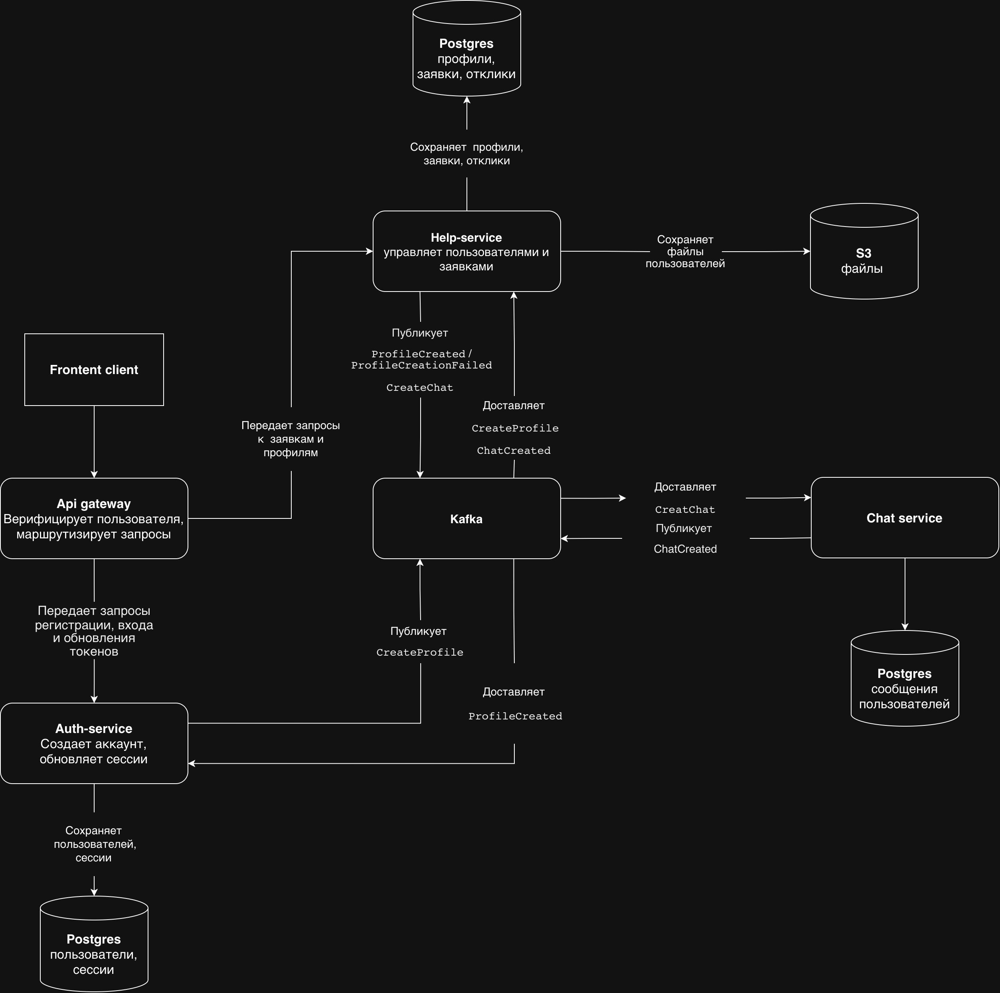

# Сервис поиска волонтеров
Сервис для быстрого и простого создания заявки на получение помощи и поиска волонтеров.

## Использование
1. Пользователь регистрируется и заполняет профиль.
2. Создает заявку с описанием помощи, местом ее оказания и дополнительной информацией.
3. Волонтеры откликаются, автор выбирает исполнителей.
4. После оказания помощи автор отмечает заявку как выполненную.

### Планируемые возможности
Регулярная помощь, чат и подтверждение выполнения волонтером.

## Архитектура сервиса
Проект состоит из трех сервисов.
### API Gateway:
* Проверяет JWT и добавляет внутренние заголовки с данными пользователя.
* Направляет запросы в соответствующие сервисы.

### Auth Service:
* Регистрирует пользователей.
* Аутентифицирует пользователей и выдает access- и refresh-токены.
* Обновляет токены и отзывает текущую сессию при выходе из аккаунта.

### Help Service:
* Управляет профилями пользователей.
* Обеспечивает создание, редактирование и удаление заявок на помощь.
* Управляет откликами волонтёров и статусами заявок.

Обмен сообщениями между сервисами выполняется через Kafka.

